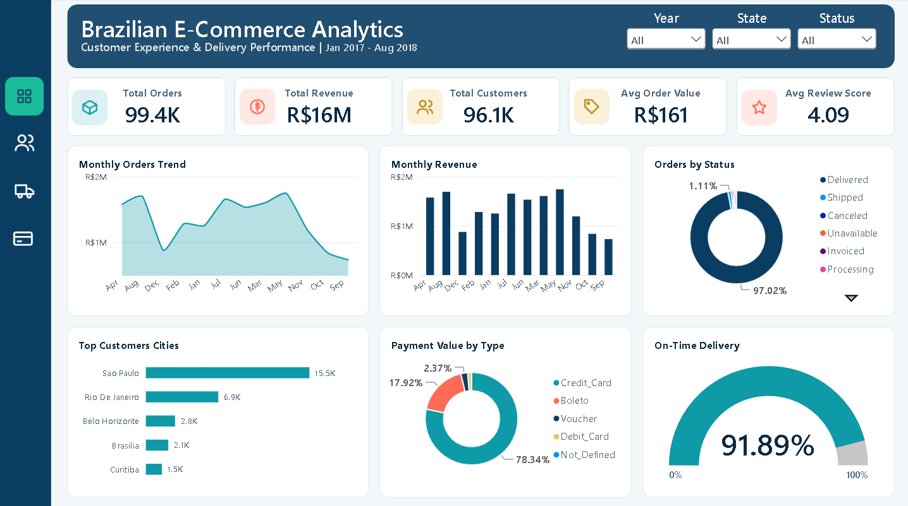

# Brazilian_Ecommerce_Analysis_SQL_PowerBI
End-to-end Brazilian E-Commerce (Olist) analysis using MySQL (30 queries) and a 4-page interactive Power BI dashboard.

# Brazilian E-Commerce Analysis (MySQL & Power BI)

End-to-end data analysis project on 100K+ Brazilian E-Commerce (Olist) records using MySQL for relational querying and a 4-page interactive Power BI dashboard tracking revenue, customer retention, delivery performance, and review ratings (Jan 2017 – Aug 2018).

# Brazilian E-Commerce Analytics – Customer Experience & Delivery Performance

An interactive, 4-page Power BI report backed by 30 SQL business queries that examines order growth, customer retention, delivery delays, payment preferences, and customer satisfaction across Brazil.

## Dashboard Preview

### 1. Executive Overview

### 2. Customer Analysis

### 3. Delivery Performance

### 4. Payment & Review Analysis

## Business Problem

The business needed a consolidated SQL and BI solution to:
- Track overall order volume, revenue (R$), average order value (AOV), and customer satisfaction
- Analyze geographic demand across Brazilian states and cities, along with repeat purchase behavior
- Evaluate on-time vs. delayed delivery performance against promised delivery dates
- Understand payment method preferences, installment usage, and how delivery delays impact review scores

## Key KPIs

| KPI | Value | Insight |
|---|---|---|
| Total Orders | 99.4K | 97.02% successfully delivered |
| Total Revenue | R$ 16.0M | Driven primarily by Credit Card payments (78.34%) |
| Unique Customers | 96.1K | 96.88% one-time buyers; 3.12% repeat customers |
| Avg Order Value (AOV) | R$ 161 | Typical basket size falls between R$ 50 and R$ 200 |
| On-Time Delivery Rate | 91.89% | Orders arrive ~12 days earlier than estimated on average |
| Avg Review Score | 4.09 / 5 | Drops from 4.3 (On-Time) to 2.6 (Delayed) |

## Dashboard Pages & Visuals

- **Page 1 – Overview**: KPI cards (Orders, Revenue, Customers, AOV, Review Score), Monthly Orders Trend, Monthly Revenue, Orders by Status donut, Top Customer Cities, Payment Value by Type, and On-Time Delivery gauge
- **Page 2 – Customer Analysis**: Total Customers, Total Orders, Avg Orders per Customer (1.03), Monthly Customer Orders, Top Cities, Customers by State treemap, Order Value Distribution, and New vs. Repeat Customers donut
- **Page 3 – Delivery Performance**: Delivered Orders (96.5K), Avg Delivery Days (12.50), On-Time Deliveries (88.6K), Delayed Deliveries (7.8K), Avg Estimated Days (24.4), Monthly On-Time %, Actual vs. Estimated Days by State, Delivery Status donut, Delivery Days Distribution, and Delayed Orders by State
- **Page 4 – Payment & Review Analysis**: Total Payment Value (R$ 16.0M), Avg Payment Value (R$ 154.1), Avg Review Score (4.09), Total Reviews (99.2K), Monthly Review Score trend, Payment Type donut, Review Score Distribution (1–5 stars), Payment Installments distribution, and Review Score vs. Delivery timing

## Filters

Interactive **Year**, **State**, and **Order Status** slicers across all four report pages, plus a left-hand icon navigation bar for seamless page switching.

## SQL Analysis (`Brazilian_Ecommerce_Analysis.sql`)

30 structured MySQL queries covering:
- **Aggregations & Grouping**: Order counts, revenue metrics, status breakdowns, and state/city rankings (`GROUP BY`, `HAVING`, `ORDER BY`)
- **Multi-Table Joins**: Linking `orders`, `customers`, `order_items`, `order_payments`, and `order_reviews` (`INNER JOIN`, `LEFT JOIN`)
- **Data Cleaning & Conditional Logic**: Handling missing values (`IFNULL`, `NULLIF`), date calculations (`DATEDIFF`), and delivery categorization (`CASE WHEN`)
- **Advanced SQL**: Subqueries, Common Table Expressions (`WITH` / CTEs), Window Functions (`LAG` for MoM comparison, `RANK` for state ranking), and `CREATE VIEW`

## Data Model

Star-schema relational model connecting five tables in both MySQL and Power BI:
- `olist_orders_dataset` (Core order lifecycle & timestamps)
- `olist_customers_dataset` (Unique customer IDs, cities, and states)
- `olist_order_items_dataset` (Product prices and freight values)
- `olist_order_payments_dataset` (Payment methods, installments, and values)
- `olist_order_reviews_dataset` (Review scores from 1 to 5 and timestamps)

## Key Learnings and Approach

- Used `DATEDIFF` and conditional `CASE` logic in SQL and DAX to benchmark actual delivery dates against estimated delivery dates
- Identified a strong operational correlation: late deliveries cut average customer ratings nearly in half (4.3 vs. 2.6)
- Discovered high geographic concentration in Southeast Brazil (`SP`, `RJ`, `MG` account for ~two-thirds of total customers) and a major retention opportunity (only 3.12% repeat rate)
- Designed a unified 4-page dashboard layout with custom navigation buttons, KPI icons, and dedicated Key Insights panels

## Tools Used

MySQL Server 8.0, MySQL Workbench, Power BI Desktop, DAX, Power Query, Data Modeling

## Repository Structure

├── README.md
├── Brazilian_Ecommerce_Analysis.sql
├── Brazilian_Ecommerce_Dashboard.pbix
├── Overview.png
├── Customer Analysis.png
├── Delivery Performance.png
└── Payment & Review.png

## How to Use

1. **SQL Queries**: Open `Brazilian_Ecommerce_Analysis.sql` in MySQL Workbench and execute the queries against the Olist dataset tables.
2. **Power BI Report**: Download `Brazilian_Ecommerce_Dashboard.pbix`, open it in Power BI Desktop, and use the left navigation icons and top slicers to explore each page.

## Author

**Vikas Pawar**  
🔗 [LinkedIn](https://www.linkedin.com/in/apka-actual-username)

Feedback and suggestions are welcome!
